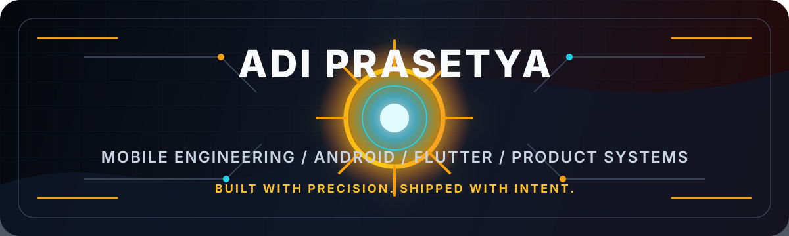
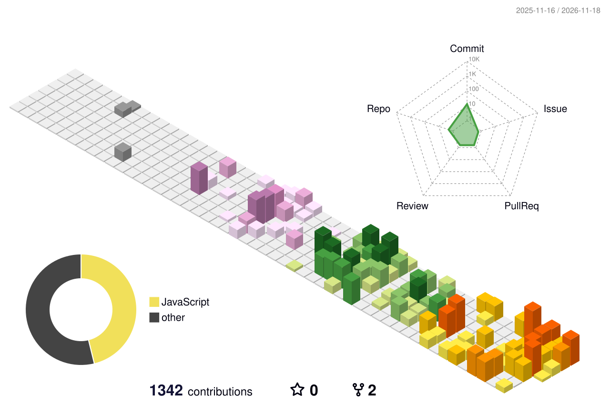

 

---

## About

I'm a **Mobile & Full-Stack Developer** from Indonesia and the founder of **[Buketmu](https://buketmu.com)**, a website builder that 120+ florists now use to sell online. By day I build the Android TV in-room entertainment system at **LifeMedia**, which runs in the rooms of 10+ hotel clients. Before that I shipped a Flutter app for the Bontang city government and rebuilt the Narajiwa Android app.

Most of my work is **Kotlin and Flutter** on the client, with **Laravel**, React, and Docker on the server when a product needs its own backend. I also teach: I was a teaching assistant for Mobile App Development at Universitas Sebelas Maret, where I study Informatics.

## Experience

<table>
  <tr>
    <td width="30%"><strong><a href="https://buketmu.com">Buketmu</a></strong> Founder Jun 2026 - now</td>
    <td>Built a website builder for Indonesian florists and bouquet sellers, solo: product, engineering, design, and marketing. Grew to <strong>120+ active florist websites</strong> without paid ads, with <strong>9+ storefront templates</strong> and a <strong>99/100</strong> PageSpeed performance score.</td>
  </tr>
  <tr>
    <td><strong>LifeMedia</strong> Mobile (Full-stack) Developer Aug 2025 - now</td>
    <td>Maintain a white-label Android TV template (Kotlin & Java) and extend it with custom features for <strong>10+ hotel clients</strong>. Laravel REST APIs keep room data in sync. Firebase monitoring holds a <strong>98.35% crash-free</strong> session rate. Also built <strong>MyLM Mobile</strong>, the Flutter self-service app for LifeMedia's broadband subscribers.</td>
  </tr>
  <tr>
    <td><strong>Dinas Perkim Kota Bontang</strong> Mobile Developer (Contract) Sep 2025 - Apr 2026</td>
    <td>Built a Flutter app from scratch for housing aid tracking, used by <strong>1,000+ citizens</strong> and officials across <strong>15 districts</strong>. Clean Architecture, feature modules, dual-role access.</td>
  </tr>
  <tr>
    <td><strong>Narajiwa</strong> Android Developer (Contract) Jul 2025 - Oct 2025</td>
    <td>Refactored a WebView-based app: install size down <strong>44%</strong>, <strong>82% adoption</strong> of the new release after native navigation and FCM fixes. Handled the <a href="https://play.google.com/store/apps/details?id=id.web.narajiwa.mobile">Play Store</a> release.</td>
  </tr>
  <tr>
    <td><strong>Universitas Sebelas Maret</strong> Teaching Assistant Aug 2023 - Jul 2024</td>
    <td>Mentored <strong>103 students</strong> in native Android (Kotlin, Repository pattern, WorkManager) and ran Linux/OS labs for 35 more.</td>
  </tr>
  <tr>
    <td><strong>Bangkit Academy</strong> Android Development Cohort Aug 2023 - Jan 2024</td>
    <td>Led by Google, Tokopedia, Gojek, and Traveloka. Owned the mobile app and UI/UX for a 7-person capstone team.</td>
  </tr>
</table>

## Selected Work

<table>
  <tr>
    <td width="50%">
      <h3><a href="https://buketmu.com">Buketmu</a></h3>
      
My own product, which I founded: a website builder for Indonesian florists. 120+ active florist websites, 9+ storefront templates, 99/100 PageSpeed performance and 100/100 SEO.

      
Laravel · React · Inertia.js · MySQL · <a href="https://buketmu.com">Live</a> · <a href="https://adiprasetya.my.id/projects/buketmu">Case study</a>

    </td>
    <td width="50%">
      <h3><a href="https://kelolakosku.web.id">KelolaKosku</a></h3>
      
My own product for boarding house owners: rent bills go out automatically over WhatsApp, and tenants and finances are managed from a phone. 21 mobile modules, 6 background jobs.

      
Flutter · React · Docker · CI/CD · <a href="https://kelolakosku.web.id">Website</a> · <a href="https://play.google.com/store/apps/details?id=com.kelolakosku.app">Play Store</a> · <a href="https://adiprasetya.my.id/projects/kelolakosku-app">Case study</a>

    </td>
  </tr>
  <tr>
    <td width="50%">
      <h3><a href="https://pitapesan.web.id">Pitapesan</a></h3>
      
My own product: interactive digital greeting cards. The recipient plays through animated scenes and a mini-game before the message is revealed. Pay per card, from Rp9.900.

      
Laravel · React · TypeScript · Inertia.js · Framer Motion · <a href="https://pitapesan.web.id">Live</a>

    </td>
    <td width="50%">
      <h3><a href="https://adiprasetya.my.id/projects/spasiala-gis-telecom-platform">Spasiala</a></h3>
      
Telecom GIS and field survey platform that moves asset mapping from spreadsheets to the field, with offline queueing and geofence checks.

      
Flutter · Laravel · React · Inertia.js · <a href="https://spasiala.atyadev.web.id">Live</a>

    </td>
  </tr>
  <tr>
    <td width="50%">
      <h3><a href="https://adiprasetya.my.id/projects/lifemedia-hospitality-android-tv-app">LifeMedia Hospitality TV</a></h3>
      
Every hotel service on the room TV, managed remotely. Menus sync within 60 seconds.

      
Kotlin · Android TV · MVVM · Retrofit

    </td>
    <td width="50%">
      <h3><a href="https://adiprasetya.my.id/projects/mylifemedia-app">MyLM Mobile</a></h3>
      
Self-service app for LifeMedia broadband subscribers: check bills, pay via virtual account or retail outlets, request speed upgrades, and switch between several subscriber IDs in one login.

      
Flutter · Riverpod · Clean Architecture · Dio · FCM

    </td>
  </tr>
  <tr>
    <td width="50%">
      <h3><a href="https://adiprasetya.my.id/projects/sirumah-bontang-app">SiRumah Bontang</a></h3>
      
Substandard housing management for a city government, with separate flows for citizens and officials.

      
Flutter · Clean Architecture · Dio · FCM · <a href="https://play.google.com/store/apps/details?id=com.apps.sirumah.bontang">Play Store</a>

    </td>
    <td width="50%">
      <h3><a href="https://adiprasetya.my.id/projects/narajiwa-app">Narajiwa</a></h3>
      
Native Android shell for a mental wellness platform. 44% smaller install after the rebuild.

      
Kotlin · MVVM · Firebase · <a href="https://play.google.com/store/apps/details?id=id.web.narajiwa.mobile">Play Store</a>

    </td>
  </tr>
</table>

  <a href="https://adiprasetya.my.id/projects"><strong>See all projects on adiprasetya.my.id</strong></a>

## Toolkit

## GitHub Activity

Most of my work lives in private client repos. These graphs count those contributions too.

 
 

<picture>
  <source media="(prefers-color-scheme: dark)" srcset="https://streak-stats.demolab.com?user=adiprasetyaa&theme=github-dark-blue&hide_border=true&background=0D1117" />
  
</picture>

 
 

<picture>
  <source media="(prefers-color-scheme: dark)" srcset="./profile-snake/github-snake-dark.svg" />
  
</picture>

<picture>
  <source media="(prefers-color-scheme: dark)" srcset="./profile-3d-contrib/profile-night-rainbow.svg" />
  
</picture>

---

**Open to remote work, contracts, and freelance projects.** I usually reply within 24 hours.

 

<a href="mailto:adiprasetyaa11@gmail.com"><strong>Email me</strong></a> · <a href="https://www.linkedin.com/in/adiprasetyaa/"><strong>LinkedIn</strong></a> · <a href="https://adiprasetya.my.id/contact"><strong>Contact form</strong></a>

